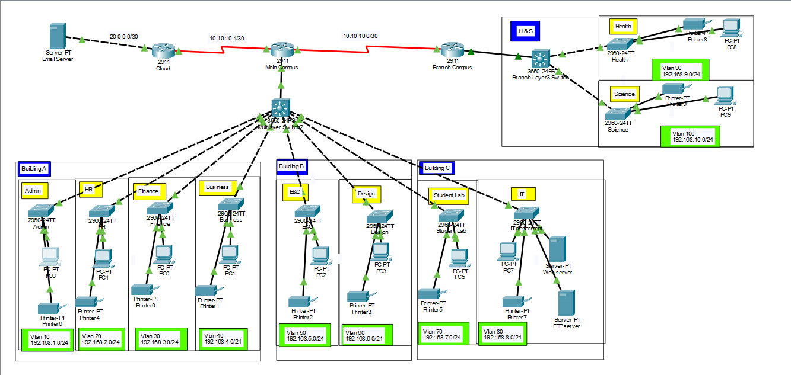
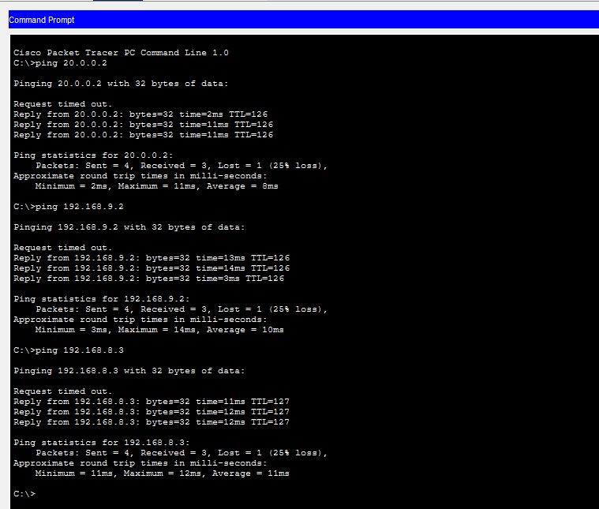

# Multi-Campus Network (Cisco Packet Tracer)

A campus network built in Cisco Packet Tracer with a Main Campus (three buildings), a Branch Campus, and a Cloud router connected to an email server. Every department has its own VLAN, and Layer 3 switches and routers connect the sites so all networks can reach each other.

## Topology



## Sites and Devices

| Site | Main devices | Departments |
|------|--------------|-------------|
| Cloud | Cloud router (2911), Email Server | - |
| Main Campus | Main Campus router (2911), Multilayer Switch2 (3650-24PS) | Building A, Building B, Building C |
| Branch Campus | Branch Campus router (2911), Branch Layer3 Switch (3650-24PS) | Health, Science |

Each department has its own 2960-24TT switch, at least one PC, and a printer. The IT department also hosts a web server and an FTP server.

## Addressing Plan

### Router links

| Link | Network | Connection |
|------|---------|------------|
| Email Server - Cloud | 20.0.0.0/30 | Copper |
| Cloud - Main Campus | 10.10.10.4/30 | Serial DCE |
| Main Campus - Branch Campus | 10.10.10.0/30 | Serial DCE |

### Departments (mask 255.255.255.0)

| Location | Department | VLAN | Network |
|----------|------------|------|---------|
| Main Campus, Building A | Admin | 10 | 192.168.1.0/24 |
| Main Campus, Building A | HR | 20 | 192.168.2.0/24 |
| Main Campus, Building A | Finance | 30 | 192.168.3.0/24 |
| Main Campus, Building A | Business | 40 | 192.168.4.0/24 |
| Main Campus, Building B | E&C | 50 | 192.168.5.0/24 |
| Main Campus, Building B | Design | 60 | 192.168.6.0/24 |
| Main Campus, Building C | Student Lab | 70 | 192.168.7.0/24 |
| Main Campus, Building C | IT | 80 | 192.168.8.0/24 |
| Branch Campus | Health | 90 | 192.168.9.0/24 |
| Branch Campus | Science | 100 | 192.168.10.0/24 |

## Design Overview

- **VLANs:** each department is in its own VLAN, created on the department switches and the Layer 3 switch at each campus.
- **Layer 3 switches:** the Multilayer Switch2 (Main Campus) and the Branch Layer3 Switch (Branch Campus) connect the department switches and route between the VLANs.
- **Routers:** the Main Campus router links the main LAN to the Branch Campus and to the Cloud router.
- **Cloud and email server:** the Cloud router connects the email server on its own 20.0.0.0/30 network, so users across the campuses can reach it.
- **Servers:** the web server and FTP server sit in the IT department (VLAN 80).

## Cabling

| Connection | Cable |
|------------|-------|
| Router to router (Cloud, Main, Branch) | Serial DCE |
| Switch to switch / Layer 3 switch | Copper cross-over |
| Router to Layer 3 switch | Copper straight-through |
| Switch to PC, printer, server | Copper straight-through |

## Testing

- PCs in different VLANs and buildings can ping each other.
- Main Campus PCs can ping Branch Campus PCs (Health and Science).
- All PCs can reach the email server, web server, and FTP server.



## Repository Contents

```
.
├── README.md
├── network_design.pkt
└── images/
    ├── topology.png
    └── ping-test.png
```

## How to Open

Open `network_design.pkt` with Cisco Packet Tracer.
"# University-network-design-using-RIP-routing-protocol" 
